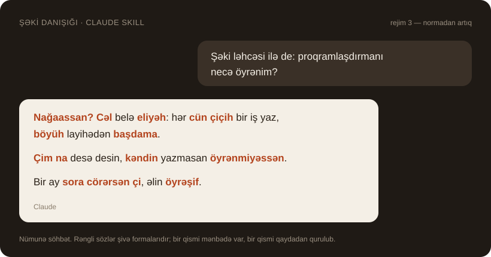

# Şəki danışığı — Claude üçün skill

Claude-a Şəki şivəsi ilə danışmağı öyrədən skill. Yazırsan "Şəki ləhcəsi ilə danış" —
o da belə cavab verir:



**English:** a Claude skill that makes Claude chat in the Sheki (Shaki) dialect of
Azerbaijani. It ships a small source-backed lexicon (31 attested words, 11 sound and
suffix rules, each with a source and page) and four intensity modes, and it tells
Claude to keep the standard form instead of inventing dialect words it has no source for.

## İçində nə var

- 31 mənbəli söz və ifadə: `həncəri` (necə), `neşin` (niyə), `havax` (nə vaxt),
  `cün` (gün), `çörəəh` (çörək), `zəqoo` (çox duzlu)...
- 11 səs və şəkilçi qaydası: k → ç, g → c, son k → h, `-yir`, `-ux`, `-suz`, `-nan / -nən`.
- Hər formanın mənbəsi və səhifəsi (`references/lexicon.json`, `rules.json`, `sources.json`).
- Claude üçün davranış qaydası: bilmədiyi yerdə forma uydurmur, ədəbi sözü saxlayır;
  kod və rəsmi sənədə toxunmur; şivəni karikaturaya çevirmir.

## Rejimlər

"Rejim 3" və ya "ultra şəki" yazmaqla keçirsən. Standart rejim 2-dir.

| № | Rejim | Eyni cümlə |
|---|---|---|
| 1 | Azaldılmış | Nağaassan bu gün? Gəl, kiçik bir iş görək, sonra çörək yeyərik. |
| 2 | Orta | Bu cün nağaassan? Cəl, çiçih bir iş görək, sonra çörəəh yeyərik. |
| 3 | Normadan artıq | Bu cün nağaassan? Cəl, çiçih bir iş cörəh, sonra çörəəh yiyərux. |
| 4 | Ultra Şəki | Bu cün nağaassan? Cəl, bir çiçih iş cörəh, onnan sora çörəəh yiyərux. |

Rejim nə qədər yüksəkdirsə, mənbədə hazır olmayan, qaydadan qurulmuş forma o qədər çoxdur.

## Quraşdırma

**Claude Code:** `seki-danisigi` qovluğunu skill qovluğuna köçür.

```bash
git clone https://github.com/ferhad24/seki-danisigi-skill
cp -r seki-danisigi-skill/seki-danisigi ~/.claude/skills/
```

Windows-da hədəf qovluq: `C:\Users\<ad>\.claude\skills\`

**claude.ai:** `seki-danisigi` qovluğunu ZIP et və Settings → Capabilities → Skills
bölməsindən yüklə.

Sonra sadəcə yaz: *"Mənimlə Şəki ləhcəsi ilə danış."*

## Şəkilisən? Səhvimizi tap

Baza kiçikdir və yerli danışanla yoxlanmayıb — ən çox lazım olan sənin qulağındır.

- Səhv və ya qəribə səslənən forma gördünsə,
  [issue aç](https://github.com/ferhad24/seki-danisigi-skill/issues/new/choose).
- Yeni söz təklif edəndə mənasını, bir nümunə cümləni və harada (şəhər / kənd),
  kimdən (yaşlı, gənc, ailə) eşitdiyini yaz.
- Eyni sözün bir neçə variantı ola bilər; biri digərini silmir, yanaşı qeyd olunur.

## Dəqiqlik sərhədi

Bu, tam Şəki lüğəti deyil — kiçik, amma mənbəli birinci versiyadır.

- Əsas mənbə bir şəhər danışanının iki yazısına əsaslanan məqalədir.
- Yerli danışanla yoxlama aparılmayıb; tezlik, kənd fərqləri və intonasiya ölçülməyib.
- Cədvəldən kənar formaları Claude qaydadan qurur — bunlar təsdiqlənmiş sitat deyil.

## Mənbələr

Baza "Şəki Dil Paketi v1" (10 oktyabr 2026) əsasında hazırlanıb. Əsas mənbələr:

- *The Sheki dialect of Northern Azeri* — https://dergipark.org.tr/en/pub/tdd/article/1412621
- *Azərbaycan dialektologiyası*
- *Azərbaycan dilinin dialektoloji lüğəti* (azleks.az)

Tam siyahı: [seki-danisigi/references/08_MENBELER.md](seki-danisigi/references/08_MENBELER.md).
Mənbə kitabları, məqalə mətnləri və səs yazıları bu repoya köçürülməyib; onların
müəlliflik hüquqları sahiblərində qalır. Bu skill rəsmi akademik nəşr deyil.
